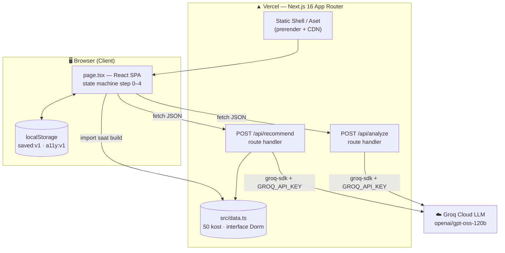
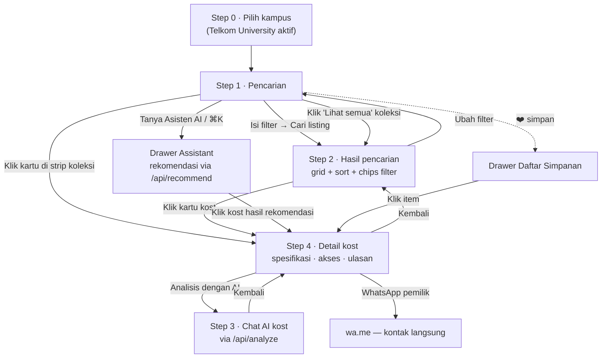
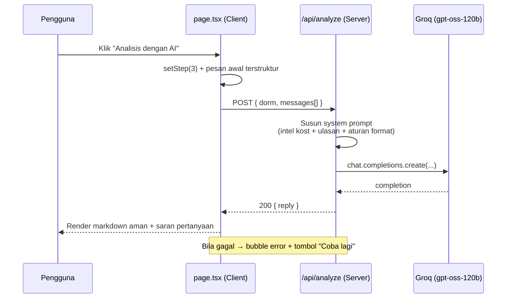

# 🏠 KostMatch

> **Kost mahasiswa, lebih mudah.**
> Platform pencarian kost untuk mahasiswa Telkom University dengan analisis ulasan berbasis AI.

🌐 **Live Demo:** [https://kostmatch.vercel.app](https://kostmatch.vercel.app)
👥 **Tim:** Kamar 216
▲ **Hosting:** Vercel

---

## Daftar Isi

1. [Pengenalan Projek](#1-pengenalan-projek)
2. [Frontend Documentation](#2-frontend-documentation)
3. [Petunjuk Localhost](#3-petunjuk-localhost)
4. [Technical Documentation](#4-technical-documentation)
5. [Backend Documentation](#5-backend-documentation)

---

## 1. Pengenalan Projek

### Latar Belakang

Mencari kost adalah salah satu masalah pertama mahasiswa baru. Informasi kost tersebar di grup chat, spanduk, dan listing tanpa standar; ulasan Google ada tetapi terlalu banyak untuk dibaca satu per satu; dan mahasiswa sering baru mengetahui kekurangan kost (air kotor, WiFi lambat, lingkungan bising) **setelah** membayar sewa. Akibatnya, keputusan diambil berdasarkan foto dan harga saja — bukan pengalaman penghuni sebenarnya.

### Solusi yang Ditawarkan

**KostMatch** mengkurasi **50 listing kost terverifikasi** di sekitar Telkom University (area Sukabirus, Sukapura, Citeureup, hingga Bojongsoang; rentang harga **Rp 375.000 – Rp 3.500.000/bulan**, jarak **0,08 – 2,8 km** dari kampus) dan menggabungkannya dengan **AI yang membaca seluruh ulasan penghuni** untuk pengguna.

Fitur utama:

| Fitur | Deskripsi |
|---|---|
| 🔎 **Filter manual** | Budget, gender, jarak (slider), rating minimum, wajib AC, listrik termasuk/token |
| ⭐ **Koleksi terkurasi** | Kualitas terbaik, paling hemat, terdekat ke kampus (strip horizontal) |
| 🤖 **Analisis AI per kost** | AI merangkum kelebihan/kekurangan dari ulasan Google penghuni, dengan saran pertanyaan & tombol coba lagi |
| ✨ **Asisten AI** | Rekomendasi kost dari bahasa natural ("kost putri di bawah 1,5jt ada AC"), pintasan `⌘/Ctrl + K` |
| ❤️ **Daftar simpanan** | Shortlist tersimpan di perangkat (localStorage) dengan aksi urungkan (undo) |
| 📱 **Kontak langsung** | Tombol WhatsApp ke pemilik kost tanpa perantara |
| 🚶 **Estimasi perjalanan** | Perkiraan waktu jalan kaki / motor / mobil + catatan lalu lintas |
| ♿ **Aksesibilitas** | Mode gelap/terang/sistem, kontras tinggi, kurangi gerak, font mudah dibaca (Lexend), fokus tebal, kurangi transparansi, skip-link, dan navigasi keyboard penuh |

### Target Pengguna

- **Primer:** Mahasiswa baru & calon mahasiswa **Telkom University** yang mencari kost di sekitar kampus.
- **Sekunder:** Mahasiswa aktif yang ingin pindah kost dan membandingkan opsi secara cepat.
- **Ekspansi (segera hadir):** ITB, Universitas Padjadjaran, UPI, Universitas Katolik Parahyangan, dan Universitas Pasundan.

---

## 2. Frontend Documentation

### Framework & Library

| Teknologi | Versi / Sumber | Peran |
|---|---|---|
| **Next.js** | 16.x (App Router, Turbopack) | Framework full-stack (UI + API routes) |
| **React** | 19 | Rendering & state management (hooks) |
| **TypeScript** | 5.x | Type safety seluruh kode |
| **Tailwind CSS** | utility classes + CSS custom properties | Styling & design system (`--km-*` tokens) |
| **lucide-react** | latest | Ikon (40+ ikon) |
| **Fontsource (CDN)** | Fraunces Variable, Plus Jakarta Sans Variable, Lexend Variable | Tipografi display, body, dan mode aksesibilitas |

### Struktur Folder

```
kostmatch/
├── public/
│   └── images/
│       ├── *.jpg / *.png / *.webp        # 50 foto kost (sesuai imageUrl di data.ts)
│       └── universities/                 # 6 foto kampus (telkom, itb, unpad, upi, unpar, unpas)
├── src/
│   ├── app/
│   │   ├── api/
│   │   │   ├── analyze/route.ts          # POST /api/analyze  — analisis ulasan kost
│   │   │   └── recommend/route.ts        # POST /api/recommend — assistant rekomendasi
│   │   ├── layout.tsx                    # Root layout
│   │   ├── page.tsx                      # Seluruh UI aplikasi (Client Component)
│   │   └── globals.css
│   └── data.ts                           # "Database" statis: 50 kost + interface Dorm
├── .env.local                            # GROQ_API_KEY (tidak di-commit)
├── next.config.ts
├── package.json
└── tsconfig.json
```

### Struktur Komponen UI (`src/app/page.tsx`)

Aplikasi adalah **single-page state machine** (`step`) di dalam satu Client Component:

| Step | Layar |
|---|---|
| `0` | Pemilihan kampus (Telkom aktif, 5 kampus lain "segera hadir") |
| `1` | Pencarian: filter manual + 3 strip koleksi terkurasi |
| `2` | Hasil pencarian: grid kartu + chips filter aktif + pengurutan |
| `3` | Chat analisis AI untuk satu kost |
| `4` | Detail kost: spesifikasi, akses ke kampus, fasilitas, ulasan, kontak |

Komponen reusable:

| Komponen | Tanggung jawab |
|---|---|
| `KostMatchApp` | State global, routing antar-step, semua handler & efek |
| `Logo` | Logo SVG dengan gradient (id unik via `useId`) |
| `SmartImage` | Gambar dengan fallback otomatis ke inisial + motif kawung bila gagal dimuat |
| `DormCard` / `StripDormCard` | Kartu kost untuk grid hasil / strip koleksi |
| `CollectionStrip` | Strip horizontal scroll-snap dengan tombol geser & fade edge |
| `ChatBubble` | Bubble chat + render markdown aman (escape HTML) + kartu kost terdeteksi + retry |
| `TypingDots` | Indikator AI sedang mengetik |
| `SwitchRow` | Toggle aksesibilitas (role="switch") |
| Drawer `assistant` / `saved` / `a11y` | Panel samping: Asisten AI, daftar simpanan, pengaturan aksesibilitas (focus-trap + `Esc`) |
| Toast system | Notifikasi + aksi "Urungkan", `aria-live="polite"` |

### Aset

- **Foto kost:** `public/images/` — 50 file, direferensikan oleh field `imageUrl` di `data.ts`.
- **Foto kampus:** `public/images/universities/` — 6 file.
- **Motif kawung & ikon select:** inline SVG data-URI di CSS (tanpa file eksternal).
- **Font:** dimuat via CDN Fontsource di dalam `<style>` komponen.

### Persistensi Client (localStorage)

| Key | Isi |
|---|---|
| `kostmatch:saved:v1` | `number[]` — id kost yang disimpan |
| `kostmatch:a11y:v1` | Objek preferensi aksesibilitas (tema, kontras, gerak, font, fokus, transparansi) |

---

## 3. Petunjuk Localhost

### Prasyarat

| Kebutuhan | Keterangan |
|---|---|
| **Node.js** | ≥ 20.9 (disarankan LTS 22) — cek: `node -v` |
| **npm** | bawaan Node.js |
| **Git** | untuk clone repositori |
| **Groq API Key** | gratis di [console.groq.com/keys](https://console.groq.com/keys) — wajib agar fitur AI berfungsi |

> ✅ **Tanpa setup database.** Seluruh data kost adalah modul TypeScript statis (`src/data.ts`).

### Langkah Instalasi & Menjalankan

```bash
# 1. Clone repositori
git clone <URL_REPO_KOSTMATCH>
cd kostmatch

# 2. Install dependencies
npm install

# 3. Buat file environment
#    macOS/Linux:
cp .env.example .env.local
#    Windows (CMD):
copy .env.example .env.local

# 4. Buka .env.local dan isi API key Groq kamu:
#    GROQ_API_KEY=gsk_xxxxxxxxxxxxxxxxxxxxx

# 5. Jalankan development server (Turbopack)
npm run dev
```

Buka **[http://localhost:3000](http://localhost:3000)** di browser. 🎉

### Build Produksi (opsional)

```bash
npm run build
npm start
```

### Troubleshooting

| Masalah | Solusi |
|---|---|
| Chat AI membalas error `GROQ_API_KEY is missing` | Isi `GROQ_API_KEY` di `.env.local`, lalu **restart** `npm run dev` |
| Port 3000 terpakai | `npm run dev -- -p 3001` |
| Foto kost tidak muncul | Komponen `SmartImage` otomatis menampilkan fallback inisial — pastikan folder `public/images/` lengkap |
| Tanpa API key | Aplikasi tetap berjalan penuh (filter, koleksi, detail, simpanan); hanya fitur AI yang nonaktif |

---

## 4. Technical Documentation

### Arsitektur Sistem

Monolit **Next.js App Router** yang di-deploy ke **Vercel**: satu Client Component besar untuk UI, dua **serverless route handler** untuk AI, dan **modul data statis** sebagai database. Tidak ada server/database terpisah — kunci API Groq hanya hidup di sisi server.



### Diagram Alur Program (Navigasi Pengguna)



### Sequence Diagram — Panggilan AI



### Keputusan Teknis

- **Data statis TypeScript, bukan DB eksternal** → nol biaya operasional, query instan di client, cukup untuk 50 listing terkurasi; schema tetap ketat via `interface Dorm`.
- **Kunci API hanya di server** → `GROQ_API_KEY` dibaca di route handler, tidak pernah bocor ke bundle client.
- **Groq + `openai/gpt-oss-120b`** → inferensi sangat cepat sehingga chat terasa responsif; perilaku model (prompt, guardrail, format jawaban) diatur sepenuhnya di `route.ts`.
- **Prerender-safe** → nilai tidak stabil (mis. tahun footer) dibaca di `useEffect`, sehingga shell tetap statis dan navigasi instan.
- **Markdown chat di-escape dulu** sebelum dirender → aman dari injeksi HTML dari output model.

---

## 5. Backend Documentation

### Ringkasan

Dua **Next.js Route Handler** (serverless function di Vercel). Keduanya memanggil **Groq SDK** dengan model `openai/gpt-oss-120b`, `temperature: 0.7`, `max_tokens: 4096`, dan menjawab dalam Bahasa Indonesia (Aku/Kamu) dengan format singkat.

### Endpoint

#### `POST /api/analyze` — Analisis Ulasan Kost

Menganalisis satu kost berdasarkan data + ulasan Google penghuni.

**Request body:**

```json
{
  "dorm": {
    "id": 3,
    "name": "Kirana Kost Bandung",
    "price": 2400000,
    "hasAC": true,
    "distanceKm": 0.08,
    "googleReviews": ["Kos kirana emang nantap rapih bersih", "Bagus", "Jelas"]
  },
  "messages": [
    { "role": "user", "content": "Bagaimana kualitas WiFi, apakah kost ini cocok untuk belajar?" }
  ]
}
```

> `dorm` adalah objek lengkap bertipe `Dorm` (lihat schema di bawah); contoh di atas dipotong.

**Response `200`:**

```json
{ "reply": "Kost ini **bersih dan rapi** menurut penghuni. ..." }
```

**Response `500`:**

```json
{ "error": "GROQ_API_KEY is missing" }
```

**Contoh cURL:**

```bash
curl -X POST http://localhost:3000/api/analyze \
  -H "Content-Type: application/json" \
  -d '{"dorm":{"id":3,"name":"Kirana Kost Bandung","price":2400000,"hasAC":true,"distanceKm":0.08,"googleReviews":["bersih"]},"messages":[{"role":"user","content":"Kost ini bagus?"}]}'
```

#### `POST /api/recommend` — Asisten AI 

Merekomendasikan kost dari **seluruh database** (konteks 50 listing disuntikkan ke system prompt: nama, harga, AC, jarak, gender, rating). Aturan: pilih **tepat satu** kost bila pengguna minta "terbaik"; maksimal 1–2 untuk permintaan umum; jawaban < 45 kata.

**Request body:**

```json
{
  "messages": [
    { "role": "user", "content": "Kost putri dengan AC di bawah 2,5jt, dekat kampus" }
  ]
}
```

**Response `200`:**

```json
{ "reply": "Aku pilih **Kost Pondok Amanah** (Rp 2.100.000) — ..." }
```

**Response `500`:** `{ "error": "<pesan error>" }`

### Konfigurasi Model

| Parameter | Nilai |
|---|---|
| Provider | Groq Cloud (`groq-sdk`) |
| Model | `openai/gpt-oss-120b` |
| Temperature | `0.7` |
| Max tokens | `4096` |
| Bahasa jawaban | Indonesia (Aku/Kamu), bullet `-`, fakta penting `**bold**` |

### Database Schema

Tidak ada DB eksternal — sumber data adalah **`src/data.ts`**: `export const dorms: Dorm[]` berisi **50 record**.

**`interface Dorm`:**

| Field | Tipe | Keterangan |
|---|---|---|
| `id` | `number` | Primary key unik (1–50) |
| `name` | `string` | Nama kost |
| `price` | `number` | Harga sewa per bulan (IDR) |
| `gender` | `string` | `Putra` / `Putri` / `Campur` / `Semua` / `Putra / Putri` |
| `distanceKm` | `number` | Jarak lurus ke Telkom University (km) |
| `rating` | `number` | Rating Google 0–5 (`0` = belum ada ulasan) |
| `reviewCount` | `number` | Jumlah ulasan Google |
| `hasAC` | `boolean` | Kamar ber-AC |
| `facilities` | `string[]` | Daftar fasilitas |
| `roomType` | `string` | Tipe kamar (mis. `Premium AC`) |
| `roomSize` | `string` | Ukuran (mis. `3x4 meter`) |
| `bathroomType` | `string` | `Dalam (Private)` / `Luar (Shared)` |
| `electricityIncluded` | `boolean` | Listrik termasuk sewa vs token |
| `nearbyFacilities` | `string[]` | Fasilitas sekitar + jaraknya |
| `trafficNote` | `string` | Catatan waktu tempuh light/peak |
| `googleReviews` | `string[]` | Kutipan ulasan penghuni (sumber RAG untuk AI) |
| `imageUrl` | `string` | Path foto di `public/images/` |
| `address` | `string` | Alamat lengkap |
| `whatsapp` | `string` | Nomor pemilik (dibersihkan ke format `wa.me` di client) |

**Penyimpanan sisi client (localStorage):** `kostmatch:saved:v1` → `number[]` (id tersimpan) · `kostmatch:a11y:v1` → preferensi aksesibilitas.

### `.env.example`

Buat file bernama `.env.example` di root repositori:

```env
# Groq API Key — dapatkan gratis di https://console.groq.com/keys
# Salin file ini menjadi .env.local lalu isi nilainya.
GROQ_API_KEY=gsk_xxxxxxxxxxxxxxxxxxxxxxxxxxxxxxxx
```

> ⚠️ `.env.local` sudah masuk `.gitignore` — **jangan pernah commit API key asli.** Untuk deploy Vercel, set `GROQ_API_KEY` di *Project Settings → Environment Variables*.

---

## 👥 Tim

**Team Kamar 216** — KostMatch © 2026
